# passwd-audit

passwd-audit reads a `passwd` or `shadow` file and reports the account problems that matter in a Linux review: a second account with UID 0, accounts with no password, password hashes sitting in the world-readable `passwd` file, MD5 or DES hashes in `shadow`, system accounts that can log in, duplicate UIDs and names, and hashes that never expire. The file type is detected from the field count (7 for `passwd`, 9 for `shadow`).



**Live demo:** https://jvch0512.github.io/passwd-audit/ (Synthetic account files, fake hashes.)

COBOL (GnuCOBOL). The demo page is rendered from the tool's `--tsv` output by `scripts/site.py` (Python 3, only needed to regenerate the page).

## Use

```bash
make build
./build/passwd-audit examples/passwd
./build/passwd-audit examples/shadow --tsv
./build/passwd-audit /etc/passwd --fail-on high       # exit 1 on any high finding
```

Pass one or more files. Copy `/etc/shadow` to a safe place before auditing it, and do not paste its hashes into tickets.

| Rule | Severity | What it catches |
|---|---|---|
| PWD001 | high | an account other than `root` with UID 0 |
| PWD002 | high | an empty password field (`passwd` or `shadow`): login without a password |
| PWD003 | medium | a password hash stored in `passwd` instead of `x` |
| PWD004 | high | a `shadow` hash that is MD5 (`$1$`) or traditional DES |
| PWD005 | medium | a system account (UID 1 to 999) with an interactive shell |
| PWD006 | medium | a UID shared by two accounts |
| PWD007 | low | a real hash in `shadow` that never expires (empty or 99999 maximum age) |
| PWD008 | medium | the same user name twice |
| PWD000 | info | a line that is neither a `passwd` nor a `shadow` entry |

See [examples](examples) and [docs/sample-output.txt](docs/sample-output.txt).

## Limits

- Up to 20 files per run, 2000 accounts per file at most and lines up to 1024 characters. Longer lines are cut.
- `group` and `gshadow` are not read. Membership of privileged groups is a separate review.
- NIS entries (`+user`) and LDAP accounts are not expanded.
- Locked accounts (`!` or `*` at the start of the hash) are skipped by the expiry and hash rules.

## Where it fits

Linux hardening and audit work: account hygiene checks for CIS benchmark reviews and for inherited servers.

## Tests

```bash
make test    # 62 checks: rule table, 3000 random files, hostile input and exit codes
```

MIT.

## Code scanning (SARIF)

`scripts/tsv2sarif.py` converts the `--tsv` output into SARIF 2.1.0, so findings show up in GitHub code scanning:

```sh
build/passwd-audit examples/passwd examples/shadow --tsv | python3 scripts/tsv2sarif.py --tool passwd-audit --prefix examples > results.sarif
```

Upload `results.sarif` with `github/codeql-action/upload-sarif`. Severities map to SARIF levels (critical and high to error, medium to warning, low and info to note) and to a `security-severity` score.
